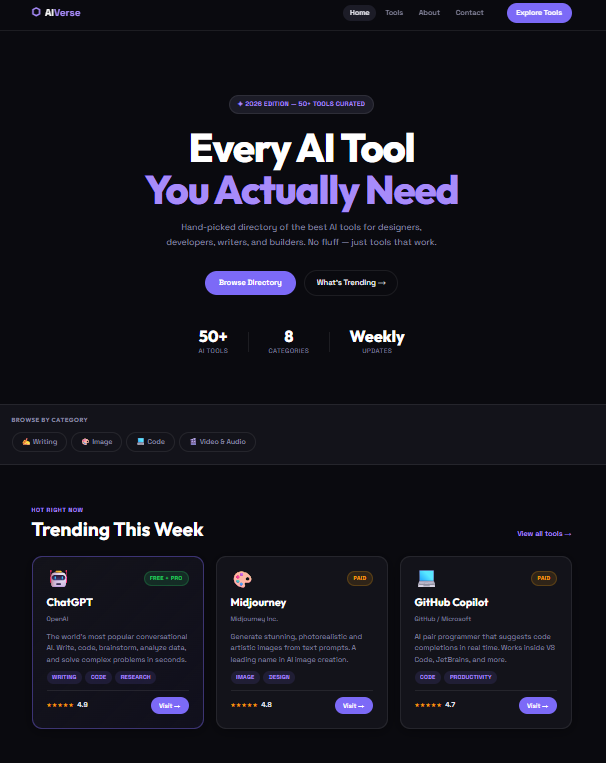

# 🔮 AI Verse

**Discover the World of Artificial Intelligence in One Place.**

AI Verse is a curated, multi-page directory of AI tools across writing, image generation, coding, video, and audio. Built as a frontend development project for **DecodeLabs Batch 2026**, it helps designers, developers, writers, and creators explore useful AI tools in one place.

🌐 **Live Website:** [Explore AI Verse](https://ai-verse-six.vercel.app/)

💻 **GitHub Repository:** [Fiza-batool/AI-Verse](https://github.com/Fiza-batool/AI-Verse)

---

## 🖥️ Website Preview

[](https://ai-verse-six.vercel.app/)

*Click the screenshot to visit the live website.*

---

## 📖 About the Project

AI Verse is a hand-curated directory featuring **50+ AI tools** for people interested in artificial intelligence, creativity, productivity, and software development.

The project is built with HTML5, CSS3, and vanilla JavaScript without external frontend frameworks or a build step. Its multi-page structure, responsive layout, and interactive search and category filters provide a simple way to discover AI tools.

The project was developed to practice frontend development, responsive web design, accessibility, and JavaScript interactions.

---

## ✨ Features

- **Multi-page website:** Home, Tools, About, and Contact pages.
- **50+ AI tools:** A curated collection across different categories.
- **Live search:** Find tools using the search functionality.
- **Category filtering:** Browse tools by category without reloading the page.
- **Responsive navigation:** Hamburger menu for smaller screens.
- **Contact form:** Client-side validation for name, email, and message fields.
- **Responsive design:** Layout adapts to desktop, tablet, and mobile screens.
- **Accessibility support:** Semantic HTML, skip-to-content link, visible focus states, and ARIA attributes.
- **Reduced-motion support:** Respects the user's `prefers-reduced-motion` setting.
- **Reusable styling:** CSS custom properties for colors, radii, and shadows.
- **Clean URLs:** Vercel configuration supports clean routes.

---

## 🗂️ Project Structure

```text
AI-Verse/
├── index.html       # Home page
├── tools.html       # AI tools directory with search and filters
├── about.html       # Project information and curation process
├── contact.html     # Contact form and validation
├── style.css        # Styling and responsive layouts
├── homepage.png     # Website preview screenshot
└── README.md        # Project documentation
```

---

## 🛠️ Technologies Used

| Technology | Purpose |
|---|---|
| HTML5 | Semantic website structure |
| CSS3 | Styling, layouts, and responsive design |
| Google Fonts | Outfit and Space Grotesk typography |
| Vercel | Website deployment and hosting |
| Git & GitHub | Version control and project hosting |

---

## 📚 AI Tool Categories

| Category | Example Tools |
|---|---|
| ✍️ Writing & Content | Claude, Jasper, Copy.ai, Grammarly |
| 🎨 Image Generation | DALL·E, Stable Diffusion, Adobe Firefly, Leonardo AI |
| 💻 Code & Development | Cursor, Tabnine, Replit AI, v0 |
| 🎬 Video & Audio | Runway, ElevenLabs, Sora, Udio |

*Tool availability, names, and features may change over time.*

---

## 🚀 Run the Project Locally

AI Verse is a static website, so no package installation or build process is required.

### Prerequisites

- A modern web browser
- Git (optional, for cloning)
- Python (optional, for running a local server)

### 1. Clone the Repository

```bash
git clone https://github.com/Fiza-batool/AI-Verse.git
```

### 2. Open the Project Folder

```bash
cd AI-Verse
```

### 3. Run the Website

**Option A — Open directly**

Open `index.html` in your browser.

**Option B — Use a local server**

```bash
python -m http.server 8000
```

Then open:

```text
http://localhost:8000
```

---

## ☁️ Deployment

AI Verse is deployed using [Vercel](https://vercel.com/).

To deploy your own copy:

1. Push the project to a GitHub repository.
2. Sign in to Vercel.
3. Select **Add New → Project**.
4. Import your GitHub repository.
5. Select **Other** as the framework preset, if prompted.
6. Leave the build command empty if Vercel detects a static site that requires no build.
7. Deploy the project.

The included `vercel.json` file provides the project's deployment configuration.

**Live Demo:** [https://ai-verse-six.vercel.app/](https://ai-verse-six.vercel.app/)

---

## ♿ Accessibility & Responsive Design

The project includes accessibility and usability considerations such as:

- Semantic HTML elements and landmarks
- A skip-to-content link
- Active navigation indicators using `aria-current`
- Visible keyboard focus states
- Responsive navigation for mobile devices
- Support for reduced-motion preferences

---

## 🎯 Learning Outcomes

Through this project, I practiced:

- Building a multi-page website using HTML, CSS, and JavaScript
- Creating responsive layouts with Flexbox, Grid, and media queries
- Implementing dynamic search and category filters
- Validating form inputs using JavaScript
- Organizing reusable styles with CSS custom properties
- Considering accessibility and mobile usability
- Deploying a static website with Vercel
- Managing project files with Git and GitHub

---

## 👩‍💻 Developer

**Fiza Batool**

Web Developer | AI Applications & Automation

- **GitHub:** [Fiza-batool](https://github.com/Fiza-batool)
- **Project Repository:** [AI-Verse](https://github.com/Fiza-batool/AI-Verse)
- **Live Project:** [AI Verse](https://ai-verse-six.vercel.app/)

---

## 🙌 Acknowledgements

- Developed as a learning project for **DecodeLabs Batch 2026**.
- Created to practice frontend development and modern web design principles.
- Thanks to the creators and maintainers of the AI tools featured in the directory.

AI tool names, logos, and trademarks belong to their respective owners.

---

## 📄 License

This project was created for educational and learning purposes. No separate open-source license is specified unless a license file is added to the repository.
